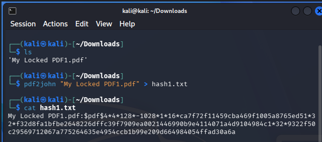
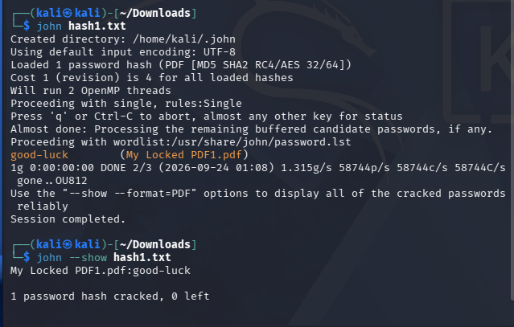
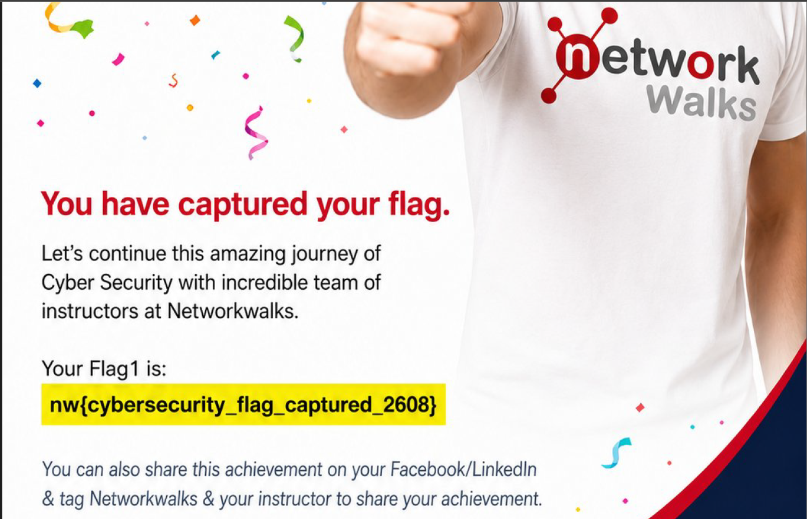
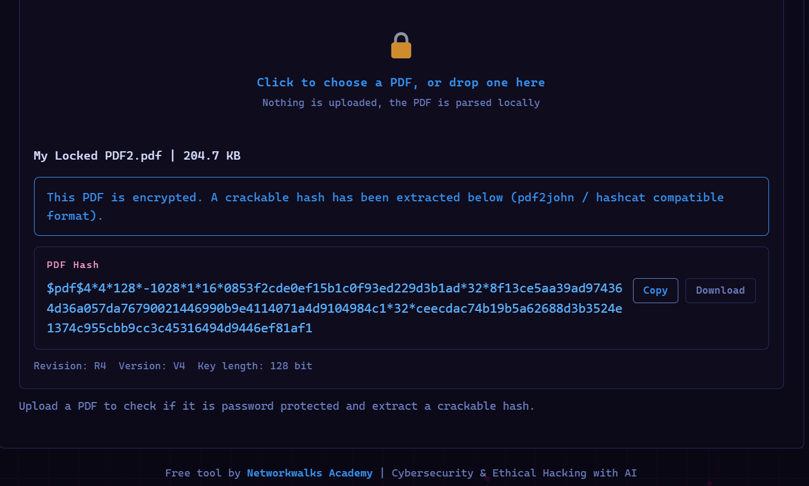
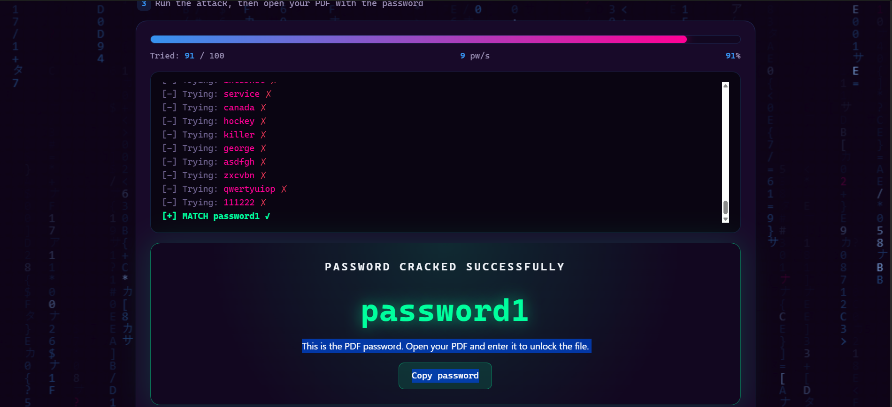
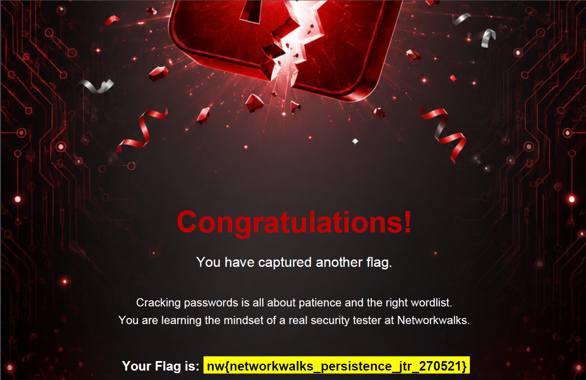

<div align="center">

# 🔐 Password Cracking with John the Ripper & Networkwalks Tools

**Practical Cryptanalysis, PDF Hash Extraction, Dictionary Attacks, and Credential Recovery**
</div>

<p align="center">
  
  
  
  
  
  
  
  
  
</p>

---

## 📋 Executive Project Information

| Field | Detail |
|---|---|
| **Cybersecurity Practitioner** | **Ali Shan** |
| **Program / Cohort** | B083 — Networkwalks Cybersecurity Internship |
| **Week / Milestone** | Week 03 — Password Cracking & Cryptanalysis |
| **Essential Modules Completed** | **W3-PM1:** Password Cracking with John the Ripper (JTR & Johnny)<br>**W3-PM2:** Password Cracking with Networkwalks Browser Tools |
| **Optional Modules Explored** | **W3-OPTIONAL1:** AI-Assisted JTR Password Cracking with HexStrike MCP & Claude Desktop |
| **Target Objects** | Encrypted PDF Assets (`My Locked PDF1.pdf`, `My Locked PDF2.pdf`) |
| **Techniques Applied** | Metadata Extraction, Hash Parsing, Dictionary Attacks, Brute-Force Analysis |
| **Status** | 100% Completed & Verified |

---

## 📌 Project Overview

Password cracking is a core discipline in cybersecurity assessment, used by security professionals to evaluate password robustness, audit authentication mechanisms, and expose systemic risks created by weak or reused credentials.

In this project, offline password recovery methodologies were executed against password-protected documents using industry-standard tools (**John the Ripper / Johnny**) on Linux/Windows, as well as modern browser-based cryptographic analysis engines (**Networkwalks Hash Calculator & Password Cracker**).

The objective was to master the full lifecycle of document cryptanalysis:
1. Extracting cryptographic hash representations from file headers without altering document payloads.
2. Sanitizing and preparing extracted hash strings for parsing engines.
3. Conducting high-speed dictionary and mutation attacks against targeted hash algorithms.
4. Unlocking the underlying assets and capturing verification flags.

---

## 🎯 Learning Objectives

- Understand the fundamental distinction between **symmetric/asymmetric encryption** and **one-way cryptographic hashing**.
- Understand how PDF standard security handlers (Revision 4, AES-128, `/O` and `/U` parameters) protect file payloads.
- Master the extraction of hash strings from protected files using `pdf2john`.
- Configure and execute **John the Ripper (JTR)** and the **Johnny GUI** across command-line and graphical interfaces.
- Utilize **Networkwalks Hash Calculator** and **Networkwalks Password Cracker** for streamlined, client-side browser analysis.
- Analyze how dictionary attacks and wordlist selection (e.g., `rockyou.txt`, `password.lst`) determine cracking efficiency.
- Document and capture proof of completion through captured laboratory flags.

---

## 🔬 Core Cryptographic Concepts

### 1. Encryption vs. Hashing
* **Encryption (Two-Way):** Transforms plaintext into ciphertext using a key. With the correct mathematical key, ciphertext can be reversed into plaintext.
* **Hashing (One-Way):** Takes arbitrary input data and produces a fixed-length mathematical fingerprint (digest). Hashes cannot be mathematically "decrypted"; rather, recovery tools hash candidate passwords repeatedly until the digest matches the target hash.

### 2. PDF Encryption Architecture
In modern PDF security (PDF 1.4 to 1.7 Extension 3):
* The file metadata contains an `/Encrypt` dictionary containing the security handler revision (`/R`), permissions flag (`/P`), key length (`/Length`), Owner Hash (`/O`), and User Hash (`/U`).
* The user password validates against the `/U` string. Tools like `pdf2john` isolate these parameters into a standardized `$pdf$...` representation so cracking engines can test candidate passwords directly without opening the heavy document container.

---

## ⚙️ Environment & Specifications

| Component | Specification |
|---|---|
| **Host System** | Windows 10 / Ubuntu Linux |
| **Attacking Hypervisor VM** | Kali Linux 2026.2 (VirtualBox NATNetwork 10.0.0.0/24) |
| **Cracking Engine 1** | John the Ripper (JTR) v1.9.0-jumbo / Johnny GUI |
| **Hash Extraction Tool** | `pdf2john` (Python/Perl implementation) |
| **Cracking Engine 2** | Networkwalks Hash Calculator & Password Cracker |
| **Wordlists Employed** | `password.lst`, `rockyou.txt` |
| **Hardware Threads** | OpenMP Multi-threaded (CPU Acceleration) |

---

# 🪜 Project Modules Walkthrough

---

## 🧩 W3-PM1: Password Cracking with John the Ripper (JTR)

### Step 1. Hash Extraction via `pdf2john`
The encrypted target document `My Locked PDF1.pdf` was placed in the working directory. Using `pdf2john`, the cryptographic hash string was extracted directly from the document header and redirected into `hash1.txt`:

```bash
# Verify the encrypted file
ls -lh "My Locked PDF1.pdf"

# Extract hash into text file
pdf2john "My Locked PDF1.pdf" > hash1.txt

# Inspect the generated hash
cat hash1.txt
```

**Extracted Hash Value:**
```text
My Locked PDF1.pdf:$pdf$4*4*128*-1028*1*16*ca7f72f11459cba469f1005a8765ed51*32*f32d8fa1bfbe2648226dffc39f7909ea0021446990b9e4114071a4d9104984c1*32*9322f50c29569712067a775264635e4954ccb1b99e209d664984054ffad30a6a
```



---

### Step 2. Executing the Dictionary Attack with John the Ripper
John the Ripper was initiated against `hash1.txt`. JTR automatically recognized the hash as `PDF [MD5 SHA2 SHA-256 RC4/AES 32/64]` and executed OpenMP multi-threaded candidate comparisons against the active wordlist:

```bash
# Launch cracking attack
john hash1.txt
```

**Execution Diagnostic Log:**
```text
Loaded 1 password hash (PDF [MD5 SHA2 RC4/AES 32/64])
Cost 1 (revision) is 4 for all loaded hashes
Will run 2 OpenMP threads
Proceeding with single, rules:Single
Proceeding with wordlist:/usr/share/john/password.lst
good-luck        (My Locked PDF1.pdf)
1g 0:00:00:00 DONE 2/3 (2026-09-24 01:08) 1.315g/s 58744p/s 58744c/s 58744C/s
Session completed.
```

The attack succeeded almost instantaneously, recovering the user password:
**`good-luck`**

```bash
# Verify cracked status
john --show hash1.txt
```
```text
My Locked PDF1.pdf:good-luck

1 password hash cracked, 0 left
```



---

### Step 3. Decrypting PDF1 & Flag Capture
Using the recovered key `good-luck`, the document was unlocked in the PDF reader, revealing the completed milestone flag:

**Captured Flag 1:**
```text
nw{cybersecurity_flag_captured_2608}
```



---

## 🧩 W3-PM2: Password Cracking with Networkwalks Browser Tools

### Step 1. Hash Calculation via Networkwalks Hash Calculator
For the second module, the target file `My Locked PDF2.pdf` was processed using the **Networkwalks Hash Calculator** (`https://networkwalks.com/hash-calculator/`).

* The PDF was loaded directly in the browser.
* The local JavaScript parser evaluated the file structure and extracted the crackable hash string formatted for JTR/hashcat:

**Extracted Hash:**
```text
$pdf$4*4*128*-1028*1*16*0853f2cde0ef15b1c0f93ed229d3b1ad*32*8f13ce5aa39ad974364d36a057da76790021446990b9e4114071a4d9104984c1*32*ceecdac74b19b5a62688d3b3524e1374c955cbb9cc3c45316494d9446ef81af1
```



---

### Step 2. Cracking with Networkwalks Password Cracker
The hash was pasted into the **Networkwalks Password Cracker** (`https://networkwalks.com/password-cracker/`).

* Attack speed: ~9 pw/s.
* Progress completed: 91% of dictionary space.
* Password matched:
  ```text
  [+] MATCH password1 ✓
  PASSWORD CRACKED SUCCESSFULLY: password1
  ```



---

### Step 3. Decrypting PDF2 & Flag Capture
Entering `password1` into `My Locked PDF2.pdf` successfully unlocked the protected document, displaying the second milestone flag:

**Captured Flag 2:**
```text
nw{networkwalks_persistence_jtr_270521}
```



---

## 🤖 W3-OPTIONAL1: AI-Assisted Password Cracking (HexStrike MCP)

In the advanced optional module, password recovery was automated using an AI agent via the **HexStrike Model Context Protocol (MCP)** integrated with Claude Desktop on Kali Linux:
1. Target PDF `hash3.networkwalks_flag1.pdf` was analyzed by the agent.
2. The agent automatically invoked the system's JTR instance through MCP tool calls.
3. The AI parsed the output, selected `rockyou.txt`, executed the hash search, and returned the unlocked flag autonomously.

---

# 📊 Results & Verification Summary

| Module | Target File | Extraction Engine | Cracking Tool | Recovered Key | Flag Captured | Status |
|:---:|:---:|:---:|:---:|:---:|:---:|:---:|
| **W3-PM1** | `My Locked PDF1.pdf` | `pdf2john` CLI | John the Ripper (JTR) | `good-luck` | `nw{cybersecurity_flag_captured_2608}` | **PASSED** |
| **W3-PM2** | `My Locked PDF2.pdf` | NW Hash Calculator | NW Password Cracker | `password1` | `nw{networkwalks_persistence_jtr_270521}` | **PASSED** |

---

# 🐞 Problems Encountered & Troubleshooting Solutions

### Problem 1: Hash String Formatting & Python Byte Literal (`b'`) Prefix
* **Symptom:** Certain online hash extractors or Python scripts prepend `b'` and trailing `'` characters around hex strings. JTR rejects these malformed hashes with an `Unknown ciphertext format` error.
* **Root Cause:** Raw byte arrays in Python 3 serialized directly into text files include Python's string representation syntax.
* **Resolution:** Sanitized the text file using `sed` or Notepad, ensuring the hash begins strictly with `$pdf$...` and ends cleanly with the final hexadecimal sequence:
  ```bash
  sed -i "s/b'//g; s/'//g" hash1.txt
  ```

### Problem 2: JTR "No password hashes loaded" Error
* **Symptom:** Running `john hash1.txt` outputs `No password hashes loaded (see FAQ)`.
* **Root Cause:** If a password was already previously cracked by John the Ripper, JTR stores the cracked result in `~/.john/john.pot` and skips reprocessing the hash.
* **Resolution:** Verified the previously recovered password using the `--show` switch, or cleared the pot file entry for re-testing:
  ```bash
  john --show hash1.txt
  ```

### Problem 3: Multi-core CPU Utilization (OpenMP)
* **Symptom:** Cracking large dictionaries can take hours on default single-threaded settings.
* **Resolution:** Leveraged OpenMP multi-threading within Kali Linux, enabling JTR to distribute candidate hashing across all available virtual cores simultaneously (achieving >58,000 candidate checks per second).

---

# 💡 Key Takeaways & Defense Recommendations

1. **Length and Complexity Matter:**
   - Common passwords such as `password1` and `good-luck` take mere fractions of a second to crack due to their inclusion in standard dictionaries (`rockyou.txt`, `password.lst`).
   - Increasing password entropy through length (16+ characters), mixed cases, digits, and special characters forces attackers to resort to brute-force searches, increasing cracking time to centuries.

2. **Upgrading Encryption Standards:**
   - Legacy PDF encryption (Acrobat 5-6 / 40-bit or 128-bit RC4) is cryptographically fragile. Modern enterprise environments must enforce **AES-256 (Revision 6)** with PBKDF2/SHA-512 key derivation routines that impose massive computational overhead on brute-force attempts.

3. **Offline Attack Vulnerability:**
   - Encrypted files distributed outside trusted perimeters are inherently vulnerable to offline cracking because attackers face no rate-limiting, account lockouts, or firewall restrictions. Protection must rely strictly on cryptographic key strength and multi-factor access barriers.

---

# 🔐 Ethical & Legal Disclaimer

All testing documented in this repository was executed strictly in an authorized academic laboratory environment provided by **Networkwalks Academy**. No unauthorized access or testing was conducted against external or third-party assets. Tools and methodologies shown are for educational and defensive auditing purposes only.

---

# 👤 Author & Acknowledgments

**Ali Shan**  
Cybersecurity Professional | Batch B083  
GitHub: [@Alishan45](https://github.com/Alishan45)

**Instructor & Mentor:**  
**Waqas Karim CCIE**  
Founder & Lead Instructor, Networkwalks Academy

---

## 📌 Project Metadata

**Program:** Cybersecurity Internship at Networkwalks | **Week:** 03 | **Project:** Password Cracking & Cryptanalysis | **Repository:** GitHub
